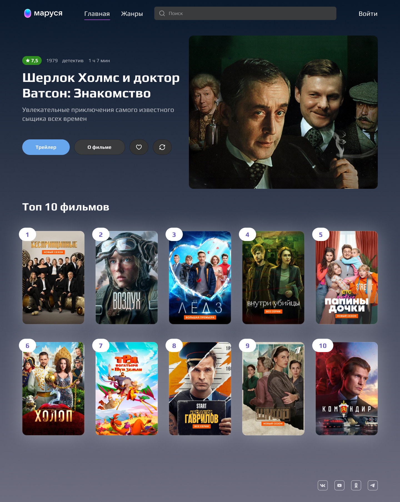

# VK Маруся 🎬 — Дипломный проект

[](https://www.typescriptlang.org/) [](https://react.dev/) [](https://vitejs.dev/) [](https://tanstack.com/query) [](https://sass-lang.com/)

> 🚀 **Дипломный проект** — Профессия Веб-разработчик на PHP 3.0 от Skillbox  
> ✨ SPA платформа на React + TypeScript
> 🎓 [Сертификат об окончании курса](./public/docs/certificate-skillbox.pdf)

---

## 💡 О проекте

**VK Маруся** — современная платформа для поиска фильмов, чтения описаний и отслеживания просмотра. Реализована как полноценная SPA-приложение с разделением бизнес-логики на `domains` и `pages`.



### Ключевые возможности:

- 🔍 **Поиск фильмов** — полная текстовая индексация
- 📂 **Жанры и категории** — удобный навигационный интерфейс
- ⭐ **Оценки и избранное** — добавление/удаление из избранного
- 📊 **Статистика просмотра** — отслеживание просмотренных фильмов
- 👤 **Личный кабинет** — профиль пользователя
- 🔐 **Авторизация** — регистрация и вход по email/паролю

### Архитектура проекта:

Использую **domain-driven design** с разделением на бизнес-сущности (`domains/`) и страницы (`pages/`):

```
src/
├── app/           # Корневой компонент, провайдеры (Query, Router)
├── pages/         # Страницы (маршруты React Router):
│   └── each-page/ ├── components/  (уникальные компоненты для этой страницы)
│                 │ └── Page.tsx
├── domains/       # Бизнес-сущности с полной логикой:
│   ├── movie/     # Сущность "Фильм":
│   │   ├── components/    (MovieCard, MoviePoster - переиспользуемые)
│   │   ├── hooks/         (useMovie, useFavorites)
│   │   ├── types/         (типы из API)
│   │   └── utils/         (форматирование, helpers)
├── shared/        # Общие компоненты и утилиты:
│   ├── components/    (кнопки, инпуты - UI без бизнес-логики)
│   ├── hooks/         (общие хуки)
│   └── utils/         (утилиты)
└── assets/         # Статические файлы
```

---

## 🛠️ Технологии

- ⚡ React.js + TypeScript (Vite)
- 🧭 React Router — роутинг
- 🔄 TanStack Query — state management
- 💊 Orval — генерация типов API
- 🎨 SCSS + CSS Modules — стилизация
- ✅ Biome — форматирование и линтинг

---

## 📦 Установка и запуск

```bash
pnpm install
pnpm dev           # Запуск dev-сервера
pnpm build         # Сборка проекта
pnpm preview       # Локальный просмотр сборки
```

### Доступные команды:

- `pnpm lint` — проверка кода Biome
- `pnpm format` — форматирование Biome
- `pnpm generate:api` — генерация типов API (Orval)
- `pnpm generate:icons` — генерация иконок
